# 👋 Hey, I'm [Yash](https://yashthakkar.xyz)

**AI/ML engineer** with interests in robotics, backend systems, and decentralised technology.

  
  
  
  

---

## 🛠️ Tools I've worked with

<picture>
    <source media="(prefers-color-scheme: dark)" srcset="https://go-skill-icons.vercel.app/api/icons?i=python%2Ccpp%2Cjavascript%2Ctypescript%2Csolidity%2Cpytorch%2Copencv%2Clangchain%2Collama%2Creact%2Cnodejs%2Cexpressjs%2Cfastapi%2Cpostgresql%2Cmongodb%2Csqlite%2Cros%2Cmatlab%2Cdocker%2Cgit%2Clinux%2Cpostman%2Cvscode%2Chtml%2Ccss&amp;perline=13&amp;theme=dark">
    <source media="(prefers-color-scheme: light)" srcset="https://go-skill-icons.vercel.app/api/icons?i=python%2Ccpp%2Cjavascript%2Ctypescript%2Csolidity%2Cpytorch%2Copencv%2Clangchain%2Collama%2Creact%2Cnodejs%2Cexpressjs%2Cfastapi%2Cpostgresql%2Cmongodb%2Csqlite%2Cros%2Cmatlab%2Cdocker%2Cgit%2Clinux%2Cpostman%2Cvscode%2Chtml%2Ccss&amp;perline=13&amp;theme=light">
    
  </picture>

---

## A little about me

- 🤖 Interested in intelligent systems, from language models to robots.
- 🔧 I like understanding how things work by building them.
- 🌐 Find more of my work at [yashthakkar.xyz](https://yashthakkar.xyz).

---

<h2 align="center">A little after-hours activity</h2>

  <picture>
    <source media="(prefers-color-scheme: dark)" srcset="https://raw.githubusercontent.com/noMathematician1729/noMathematician1729/output/pacman-contribution-graph-dark.svg">
    <source media="(prefers-color-scheme: light)" srcset="https://raw.githubusercontent.com/noMathematician1729/noMathematician1729/output/pacman-contribution-graph.svg">
    
  </picture>

